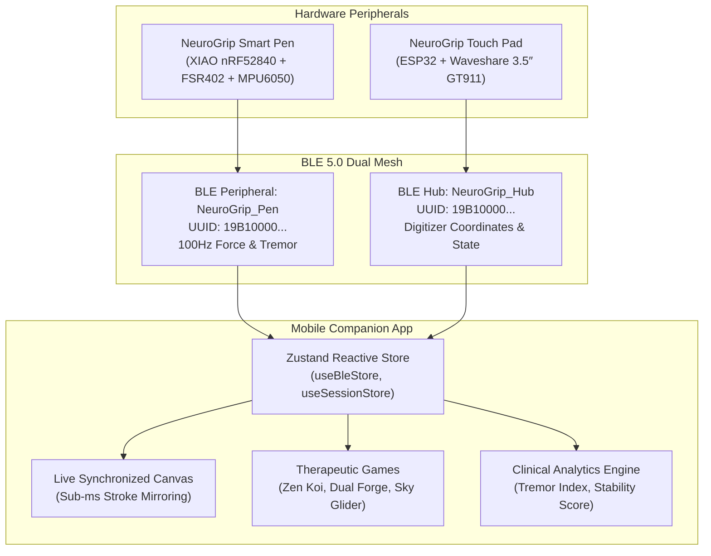

# NeuroGrip App 🧠✍️

> **Advanced Smart Pen & Capacitive Digitizer Pad Mobile Companion for Neuromuscular Monitoring, Tremor Quantification, and Fine-Motor Rehabilitation**

[](https://reactnative.dev/)
[](https://expo.dev/)
[](https://www.typescriptlang.org/)
[](LICENSE)

---

## Overview

**NeuroGrip** is a non-invasive digital biomarker and fine-motor rehabilitation platform designed for individuals with **Parkinson’s Disease**, **Essential Tremor**, and **Dysgraphia**. 

This repository contains the **NeuroGrip Companion Mobile Application**, built with React Native and Expo. It interfaces simultaneously via Bluetooth Low Energy (BLE 5.0) with:
1. **NeuroGrip Smart Pen**: Powered by Seeed Studio XIAO nRF52840 Sense Plus, FSR 402 force-sensing resistor, and MPU6050 6-DoF IMU.
2. **NeuroGrip Touch Pad**: Powered by an ESP32 DevKit V1 driving a Waveshare 3.5″ IPS Capacitive Touch LCD (ST7796S + Goodix GT911 digitizer).

---

## Key Features

### 📡 1. Dual BLE Device Hub
- Real-time connection management with the **NeuroGrip Pen** and **NeuroGrip Pad**.
- Dynamic RSSI signal indicators, battery status, and sensor calibration.
- Zero-latency auto-reconnect with multi-peripheral connection monitoring.

### ✍️ 2. Live Synchronized Canvas
- **Sub-millisecond Stroke Mirroring**: Real-time rendering of stylus gestures streamed from the ESP32 GT911 capacitive touch screen.
- **Dynamic Pressure Heatmaps**: Visual stroke width and color gradients reflecting pen pinch force from the FSR 402 sensor.
- **Bi-directional State Sync**: Clearing or switching exercises on either the mobile app or the physical pad instantly updates both displays.

### 🎮 3. Gamified Neuromuscular Therapy
- **Zen Koi Pond**: Calming trajectory exercise designed to reduce kinetic tremors and encourage steady, continuous hand movement.
- **Dual Sync Forge**: Bilateral coordination challenge requiring real-time pinch force regulation within therapeutic threshold windows.
- **Sky Glider**: Velocity-controlled target tracking exercise measuring fine motor acceleration and positional accuracy.

### 📊 4. Clinical Analytics & Biomarker Tracking
- **Tremor Frequency & Amplitude**: 100 Hz IMU time-series analysis isolating tremor peaks in the 4–8 Hz Parkinsonian and 8–12 Hz Essential Tremor bands.
- **Grip Force Deviation (GFD)**: Detection of fatigue, hypertonia, and involuntary grip clamping.
- **Micrographia Decay Slope**: Automated measurement of progressive font size reduction during prolonged writing.
- **Longitudinal Neuromuscular Stability Score**: AI-ready metrics quantifying daily motor stability trends.

### 🤖 5. On-Device AI Model & Personalized Adaptive Thresholds
- **Multi-Condition Diagnostic Classifier**: Built on trained XGBoost + LightGBM + NVIDIA Kumo-Anomaly ensemble architecture:
  - **Parkinson's Disease**: 4–7 Hz kinetic/action tremor + progressive micrographia decay slope ($\Delta \text{area} < -0.15$) + Kumo anomaly residual ($>0.335$ calibrated threshold).
  - **Essential Tremor**: 8–12 Hz high-frequency kinetic action tremor with preserved stroke amplitude.
  - **Dysgraphia**: Elevated stroke jerk metric ($>850$) + irregular pinch force variance ($>35$) + spatial disorganization.
  - **Hypertonic Clamping / Writer's Cramp**: Sustained flexor over-grip ($>320\text{g}$) triggering fatigue warnings.
- **30-Second Patient Calibration Loop**: Automatically personalizes biometric envelopes based on individual grip variance:
  - `minSafePinchGrams`: Lower boundary preventing stylus slippage.
  - `maxSafePinchGrams`: Upper safety ceiling triggering pen haptic buzzer to relieve muscle strain.
  - `maxTremorCeilingHz`: Patient-specific ceiling flagging acute tremor surges.
- **Therapist Fine-Tuning Deck**: Stepper controls in the Therapist Analytics screen allow clinical specialists to customize thresholds for individual motor recovery plans.

### 🌓 6. Minimalist Adaptive Design
- Built from the ground up with high-contrast **Light Mode** and **Dark Mode** themes.
- Ergonomically tuned typography and optical alignment adhering to WCAG 2.2 AA accessibility guidelines.

---

## Architecture



---

## Tech Stack

- **Framework**: [React Native](https://reactnative.dev/) `0.85` / [Expo](https://expo.dev/) `v56`
- **Language**: [TypeScript](https://www.typescriptlang.org/) `5.0+`
- **State Management**: [Zustand](https://github.com/pmndrs/zustand) `v5`
- **Bluetooth Low Energy**: [`react-native-ble-plx`](https://github.com/dotintent/react-native-ble-plx) with `@config-plugins/react-native-ble-plx`
- **Vector Graphics & Visuals**: `react-native-svg`
- **Navigation**: `@react-navigation/native` & `@react-navigation/bottom-tabs`
- **Audio & Haptics**: Native vibration and audio feedback for threshold breaches

---

## Getting Started

### Prerequisites
- Node.js (v18 or higher)
- npm or yarn
- Android SDK (API 34+) or an Android device with Developer Mode / USB Debugging enabled

### Installation

1. Clone the repository:
   ```bash
   git clone https://github.com/nandu123-1/NeuroGrip-App.git
   cd NeuroGrip-App
   ```

2. Install dependencies:
   ```bash
   npm install
   ```

3. Start the Expo development server:
   ```bash
   npx expo start
   ```

4. Run directly on an attached Android device:
   ```bash
   npx expo run:android
   ```

---

## BLE Communication Protocol

| Characteristic UUID | Property | Data Format | Description |
| :--- | :--- | :--- | :--- |
| `19B10001-E8F2-537E-4F6C-D104768A1214` | Notify / Read | `[uint16_t x, uint16_t y, uint8_t touch, uint16_t pressure]` | Digitizer touch point and pinch force |
| `19B10002-E8F2-537E-4F6C-D104768A1214` | Write | `[uint8_t cmd, uint8_t param]` | Command channel (`0x01`: Clear Canvas, `0x02`: Set Mode) |
| `19B10003-E8F2-537E-4F6C-D104768A1214` | Notify | `[int16_t ax, int16_t ay, int16_t az, int16_t gx, int16_t gy, int16_t gz]` | 100 Hz Raw IMU Tremor Telemetry |

---

## 👥 Contributors & Team

Contributions to **NeuroGrip App** are tracked across development, firmware, and clinical diagnostics:

| Avatar | Contributor | GitHub Profile | Role / Area |
| :---: | :--- | :--- | :--- |
|  | **Nandu** | [@nandu123-1](https://github.com/nandu123-1) | Project Lead, Mobile Architecture, On-Device AI Engine & CAD Enclosure |
|  | **Vikas Gupta** | [@vikasgupta20](https://github.com/vikasgupta20) | Core Contributor, Peripheral Integration & App Development |
|  | **Spurthi Reddy** | [@spurthireddy280](https://github.com/spurthireddy280) | Core Contributor, Clinical Analytics & Biofeedback Diagnostics |
|  | **Meela Amrutha** | [@meela-amrutha](https://github.com/meela-amrutha) | Core Contributor, Frontend & UI/UX Development |
|  | **Siddartha Anishetty** | [@siddarthaanishetty19-pixel](https://github.com/siddarthaanishetty19-pixel) | Core Contributor, Hardware Telemetry & Testing |

Track detailed individual commit metrics, lines of code, and frequency graphs on the official [GitHub Contributors Insight](https://github.com/nandu123-1/NeuroGrip-App/graphs/contributors).

---

## License

This project is licensed under the MIT License — see the [LICENSE](LICENSE) file for details.
